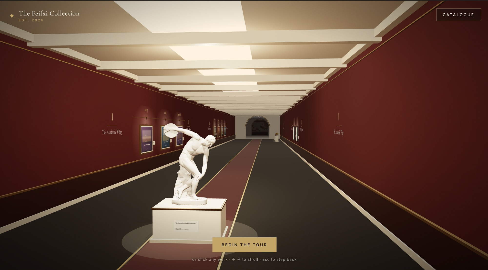

# The Feifxi Collection

A 3D portfolio disguised as a very serious museum. React + React Three Fiber, frontend only.



```bash
npm install
npm run dev      # http://localhost:5173
npm run build    # static site in dist/ — deploy anywhere (Vercel, Netlify, GitHub Pages)
```

## Publishing on GitHub Pages

The repo includes `.github/workflows/deploy.yml`: every push to `main` builds the site and publishes it.

1. Create a repo on GitHub and push this project to its `main` branch.
2. In the repo: **Settings → Pages → Build and deployment → Source: GitHub Actions**.
3. Wait for the *Deploy to GitHub Pages* run in the **Actions** tab (≈1 min), then open the link it shows.

Name the repo `<username>.github.io` to get the site at `https://<username>.github.io/`; any other name gives
`https://<username>.github.io/<repo>/`. Both work unchanged: the build uses relative paths (`base: './'` in
`vite.config.js`), and paths in `data.js` like `'/art/x.jpg'` are resolved for you (`src/asset.js`).

## Curating the museum

Everything lives in **`src/data.js`**. Each section has its own display:

| Section | Display | In `data.js` |
|---|---|---|
| The Rotunda | Life-size marble statue: About · Skills · Contact tabs | `about` (`statue.face` for your face) |
| I · Education | Gilt timeline rail with dates, frames beneath | `education.entries[]` with `start`, `end` |
| II · Certificates | Diplomas in black frames, parchment placeholder | `certificates.items[]` with `date`, optional `score` (IELTS, TOEIC, AZ-900…) |
| III · Experience | Timeline rail on the other wall | `experience.entries[]` with `start`, `end` (`'present'`) |
| IV · Trophies | Gold / silver / bronze cups, laurel for anything else | `trophies.items[]` with `place` 1, 2, 3 or 0 |
| V · Projects | **The modern wing** (through a stone archway): white walls, track lights, frameless canvases sliding through screenshots | `projects.items[]` with `images: [...]` |
| The Grand Gallery | Back to grandeur through a second archway: The Creation of Adam, with your face | `masterpiece` (`overlays[0].image: '/art/face.png'`) |

Entries marked `// MOCK` are examples: replace or delete them.
Images go in `public/art/`. Anything without an image gets a generated placeholder painting.

**Images: any shape works.** Each frame is cut to the shape of its picture (portrait certificate, ultrawide
screenshot, 4:5 photo) and grows until it hits the size limits in `HANG` (`src/scene/layout.js`); the hall
spaces works by their real width. A project's frame takes the shape of its *first* screenshot, so keep a
project's screenshots the same shape (others are matted, never cropped). A wrong path shows the placeholder
and logs `Image not found` in the console.
For fast loading, export JPG or WebP at most 2048 px on the long side (≈200–500 KB each).
Put your CV at `public/cv.pdf`. Change the wall colour in `src/scene/theme.js`.

**Deep links:** `/#project-1` opens that exhibit directly (the id from `data.js`); `/#hall` skips the intro.
**Controls:** click a work · ← → to stroll · Esc to step back · *Catalogue* for a plain list.

## Performance

The museum is built to stay smooth on phones as well as desktops:

- **Renders only when something moves.** Idle on a label, the GPU does nothing (no heat, no battery drain).
- **A pool of 4 lights follows your gaze** instead of one light per ceiling lamp; the trophy room shares one display light.
- **Adapts to the device.** Phones start at a lower pixel ratio; if frames get slow while moving, resolution steps down,
  and the mirror floor is swapped for plain polished stone as a last resort (`LADDER` in `src/scene/Experience.jsx`).
- **The intro loads first;** three.js (most of the download) arrives in its own chunk while you read it.
